# Architecture

  

Legend: amber = entry points and external systems, indigo = core logic, green = data and state, blue = validation and control, grey = observability and outputs.

## Request flow

1. The client starts the server (`mcp-ml-tools` on stdio) or connects to `POST /mcp`.
2. `McpServer` from `@modelcontextprotocol/sdk` validates arguments against each tool's zod input
   schema and rejects malformed calls before the handler runs.
3. `run()` in `server.ts` calls the pure tool function, records latency in `Metrics`, and returns the
   result twice: as pretty JSON text (for clients that only show text) and as `structuredContent`
   matching the tool's output schema.
4. `ToolInputError` (a problem the caller can fix) becomes a tool result with `isError: true`;
   any other exception is logged to standard error and reported as an internal error. The process
   never exits because of a bad call.

## Module map

| Module                     | Responsibility                                                         |
| -------------------------- | ---------------------------------------------------------------------- |
| `src/cli.ts`               | Parses flags, loads configuration, selects stdio or HTTP               |
| `src/config.ts`            | Defaults, JSON file (validated with zod), environment variables, flags |
| `src/server.ts`            | Tool and resource registration, error handling, timing                 |
| `src/http.ts`              | Stateless Streamable HTTP, bearer token, health and metrics endpoints  |
| `src/documents.ts`         | Loads text files under the allowlisted root only                       |
| `src/tools/bpe.ts`         | Byte-level BPE trainer, encoder, decoder                               |
| `src/tools/tokenize.ts`    | Token counts, token ids, cost estimates                                |
| `src/tools/bm25.ts`        | Analyzer, inverted statistics, BM25 scoring, snippets                  |
| `src/tools/statistics.ts`  | Bootstrap, McNemar, complementary error function, binomial tail        |
| `src/tools/json-schema.ts` | Draft detection, Ajv validation, error path conversion                 |
| `src/tools/injection.ts`   | Rule table, overlap resolution, risk score, redaction                  |

## Design decisions

See the architecture decision records in [docs/adr](adr/).
